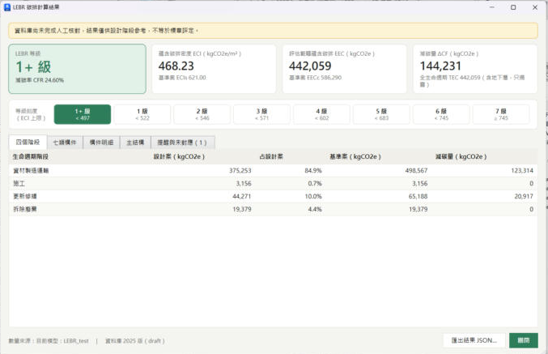

# 第1組｜LEBR 低碳建築碳排外掛

在 Revit 畫好模型後按一個按鈕，依《2025 低碳（低蘊含碳）建築評估手冊》（LEBR）算出建築的碳排放量和低碳等級（1+ 級最好，7 級最差），並可匯出結果給網頁做視覺化。

## 我要用外掛 → 看 [先看這個_快速開始.md](先看這個_快速開始.md)

五個步驟、每步都有截圖，不用會寫程式：

1. 雙擊 **安裝外掛.bat**（會自動找出你的 Revit 2024～2027）
2. 按「專案設定」（第一次會自動建立參數）
3. 在牆、窗、樓板的類型上填代號（或按「代號 JSON」→「套用代號」一次填好）
4. 按「開始計算」
5. 匯出結果

> **下載**：GitHub 這裡只放原始碼與文件（本 repo 規則不放 DLL 與 .rvt）。**要直接使用，請到 [下載頁](https://github.com/017-YiChing/2026_NCKU_BIM_Course_Group-1/releases/tag/lebr-midterm-20261102) 下載壓縮檔**，解壓縮後雙擊「安裝外掛.bat」。

| 我要 | 下載這個 |
|---|---|
| 用外掛算碳排 | [LEBR-addin-package-20261102.zip](https://github.com/017-YiChing/2026_NCKU_BIM_Course_Group-1/releases/download/lebr-midterm-20261102/LEBR-addin-package-20261102.zip)（外掛交接包，含 Revit 2024～2027 外掛、測試模型） |
| 接手資料庫 | [LEBR-database-package-20261102.zip](https://github.com/017-YiChing/2026_NCKU_BIM_Course_Group-1/releases/download/lebr-midterm-20261102/LEBR-database-package-20261102.zip)（資料庫交接包） |
| 全部 | [LEBR-full-package-20261102.zip](https://github.com/017-YiChing/2026_NCKU_BIM_Course_Group-1/releases/download/lebr-midterm-20261102/LEBR-full-package-20261102.zip)（完整交接包） |

## 我要接手或開發

| 你是 | 看這份 |
|---|---|
| 要接手整個專案 | [交接說明.md](交接說明.md) |
| 維護資料庫、改程式、做網頁的組員 | [組員操作指南.md](組員操作指南.md) |
| 只負責資料庫 | [lebr-db/交接說明_資料庫.md](lebr-db/交接說明_資料庫.md) |
| 只負責外掛 | [lebr-db/交接說明_外掛.md](lebr-db/交接說明_外掛.md) |
| 想看資料格式、構件代號規則 | [lebr-db/README.md](lebr-db/README.md) |
| 想知道外掛怎麼設計、公式怎麼算 | [計畫書](lebr-db/計畫書/計畫書.md)、[公式運算邏輯](lebr-db/計畫書/公式運算邏輯.md) |

## 現況

| 部分 | 狀態 |
|---|---|
| LEBR 資料庫（附錄一 120 筆、附錄二 187 筆、參數表） | 完成，**待人工核對**（目前為草稿） |
| 計算引擎（式 1～27） | 完成，重現手冊附錄三：CFR 20.51%、1+ 級 |
| Revit 外掛（專案設定、模型數量擷取、計算前檢查、結果視窗） | Revit 2027 實測可用；Revit 2024 組員已跑過計算；2025、2026 可編譯、尚未實測 |
| 代號 JSON（匯出／套用代號） | Revit 2027 實測可用：原始課程模型套用 `測試模型_LEBR代號.json` 後，結果和測試模型相同（1+ 級、CFR 24.60%） |
| 一鍵安裝 | 完成，自動偵測 Revit 2024～2027 |
| 網頁視覺化 | 未開始，結果格式範例見 `lebr-db/samples/sample_result.json` |

## 不在 repo 裡的東西

依本 repo 規則，編譯好的外掛、測試模型 `LEBR_test.rvt` 不提交進 Git，改放在上面的[下載頁](https://github.com/017-YiChing/2026_NCKU_BIM_Course_Group-1/releases/tag/lebr-midterm-20261102)。手冊 PDF 請自行從內政部建築研究所網站下載。
