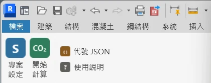

# LEBR 碳排外掛：下載與使用教學

在 Revit 裡一鍵算出建築的蘊含碳排與 LEBR 等級，再用瀏覽器看圖表。
依內政部建築研究所《低碳（低蘊含碳）建築評估手冊》2025 年版計算。

- 支援 **Revit 2024、2025、2026、2027**（用 Revit 2026 存的模型，在 Revit 2026 或 2027 開都可以算）
- 圖台網站：<https://lebr-g1-carbon-dashboard.netlify.app/>
- 第一次用，照下面 6 步做，大約 10 分鐘

---

## 第 1 步：下載

到 [GitHub 下載頁](https://github.com/017-YiChing/2026_NCKU_BIM_Course_Group-1/releases/tag/lebr-midterm-20261102)，下載 **`LEBR-addin-package-20261102.zip`**（外掛安裝包）。

> 這個 repo 只放原始碼與文件，依課程規定不放編譯好的 DLL 與 `.rvt`。
> 直接下載 repo 原始碼是**不能安裝**的，一定要下載上面的安裝包。

## 第 2 步：安裝

1. **先關掉 Revit。**
2. 在 zip 上按右鍵 →「解壓縮全部」。
3. 打開解壓縮後的資料夾，雙擊 **`安裝外掛.bat`**。
   - 它會自動找出電腦上的 Revit 2024～2027，每個版本各裝一份。
   - 看到「安裝完成」就可以關掉黑色視窗。
4. 打開 Revit。跳出「無法驗證此增益集的發行者」時，按 **「永遠載入」**。
5. 上方功能區多了一個 **LEBR** 頁籤：

| 按鈕 | 用途 |
|---|---|
| **專案設定**（大按鈕） | 填建築類別、構造與結構參數。第一次按會自動建立 LEBR 參數 |
| **開始計算**（大按鈕） | 計算前檢查 → 計算 → 結果視窗 |
| 代號 JSON（小按鈕） | 匯出或套用構件代號，別人填好的代號一次帶過來 |
| 使用說明（小按鈕） | 操作步驟摘要，可開啟完整說明 |

## 第 3 步：專案設定

打開你的模型，按 **LEBR →「專案設定」**。

1. 第一次會跳出「已自動建立 25 個 LEBR 參數」，按「關閉」。
2. 在表單填 **耗損等級、用途類型、構造**，以及主結構參數（用途係數 I、SaD、Fu、L、D0、Rs）。
3. 按 **「儲存」**。每個專案只要做一次。

## 第 4 步：填構件代號（用代號 JSON 一次填好）

外牆、外窗、帷幕、樓板要填「代號」，外掛才知道它們對應手冊附錄二的哪一種做法。

**最快的方法：套用現成的代號 JSON**

1. 按 **LEBR →「代號 JSON」→「套用代號（從 JSON 檔）」**。
2. 選這個檔案：[`LEBR碳排外掛/測試模型_LEBR代號.json`](LEBR碳排外掛/測試模型_LEBR代號.json)（安裝包裡也有一份）。
3. 外掛會依「類型名稱」把代號填到同名的牆、窗、樓板類型，並帶入專案設定。

自己的模型類型名稱不一樣時，也可以手動填：選取元件 →「編輯類型」→ 在 `LEBR_Code` 填代號（外牆本體另填 `LEBR_Code_Body`）。常用代號見 [快速開始](LEBR碳排外掛/先看這個_快速開始.md) 第 3 步。

填好後可以按「代號 JSON →匯出代號（存成 JSON 檔）」，存成檔案給組員，他們套用後就不用重填。

## 第 5 步：開始計算

按 **LEBR →「開始計算」**。

1. **計算前檢查**：列出缺漏與提醒。主結構會**自動用模型的混凝土、鋼筋量估算**（材料預設：混凝土 PLCC-042、鋼筋 PLCC-003），並寫出這次的數字。
2. 按 **「開始計算」** → 結果視窗顯示 **LEBR 等級**、減碳率 CFR、四階段與七類構件的碳排。
3. 估算會記錄到專案資訊，**算完記得存檔（Ctrl+S）**。

> 模型改過以後，再按一次「開始計算」就會依新模型重算，不必重新設定。
> 要換主結構的材料，到「專案設定 →開啟估算」選附錄一材料，按「計算並儲存」，再按「儲存」。

## 第 6 步：看結果

結果視窗下方有兩個按鈕：

- **在圖台開啟**：用瀏覽器打開圖台，首頁 3D 模型與 Dashboard 會直接顯示這次的結果。
- **匯出結果 JSON…**：存成檔案。到圖台按「Load JSON」（首頁）或「載入 JSON」（Dashboard）也能看。

圖台第一次打開會請你輸入名字（不是真的帳號，只存在你的瀏覽器），之後在 Dashboard 寫的「註記」會顯示是誰寫的。

---

## 解除安裝

關掉 Revit，雙擊安裝包裡的 **`解除安裝外掛.bat`**。

## 常見問題

| 狀況 | 怎麼辦 |
|---|---|
| 安裝時說找不到「已編譯外掛」 | 你下載的是 repo 原始碼。請到第 1 步的下載頁下載 `LEBR-addin-package-20261102.zip` |
| 安裝後 Revit 沒有 LEBR 頁籤 | 確認安裝時 Revit 是關著的；重開 Revit，並在安全性提示選「永遠載入」 |
| 計算前檢查說「缺少參數」 | 先按「專案設定」並按「儲存」，參數會自動建立 |
| 計算前檢查說有構件「未對應」 | 這些類型沒有填 `LEBR_Code`，照第 4 步填代號 |
| 「結構鋼筋 N 項…未計入」 | 這些鋼筋找不到主體或樓層。訊息會列出 ElementId，在 Revit 用「管理 → 查詢 → 依 ID 選取」找到它們 |
| 圖台顯示的不是最新結果 | 左下「資料來源」會標出計算時間；按「改看最新結果」，或關掉舊分頁再從 Revit 按一次「在圖台開啟」 |
| 等級跟預期差很多 | 先看計算前檢查的說明：主結構是用模型數量估算，還是用標準公式（模型沒有結構構件時） |

## 資料夾說明

| 資料夾 | 內容 |
|---|---|
| [`LEBR碳排外掛/`](LEBR碳排外掛/) | 外掛原始碼、LEBR 資料庫、安裝腳本、快速開始與交接文件 |
| [`LEBR圖台網站/`](LEBR圖台網站/) | 圖台網站原始碼（首頁 3D、Dashboard、註記） |

更詳細的說明：
- [快速開始（附截圖）](LEBR碳排外掛/先看這個_快速開始.md)
- [組員操作指南](LEBR碳排外掛/組員操作指南.md)
- [外掛交接說明](LEBR碳排外掛/lebr-db/交接說明_外掛.md)
- [圖台網站說明](LEBR圖台網站/README.md)
